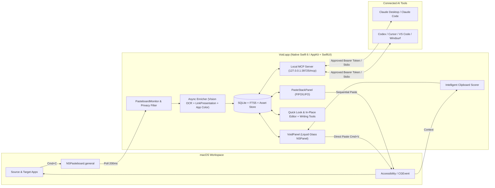

# Technical Design: Void for macOS

## Context

**Void** is a native macOS clipboard manager and productivity hub engineered as a 100% feature-complete and visually faithful local clone of **Paste for Mac** (`pasteapp.io`, Paste 6 in Liquid Glass). Paste's signature experience relies on deep macOS integration:
1. A non-activating, bottom-anchored sliding horizontal drawer (`NSPanel`) that overlays any workspace or full-screen app without stealing keyboard focus from the target application.
2. High-frequency background monitoring of `NSPasteboard.general` capable of classifying text, RTF, HTML, code, URLs, images, files/folders, and colors while filtering out confidential password-manager payloads.
3. Instantaneous full-text and inside-image OCR search (`Power Search`) with inline smart filter chips and `Jump to History` (`Command-G`).
4. Direct pasting into the active application via synthesized `CGEvent` keystrokes and an always-on-top sequential `Paste Stack` (`Shift-Command-C`).
5. A built-in local Model Context Protocol (MCP) server (`http://127.0.0.1:39725/mcp` and stdio proxy) that exposes clipboard history and pinboards to AI tools (Claude Desktop, Claude Code, Codex, Cursor, VS Code, Windsurf, and custom MCP clients).

## Goals / Non-Goals

**Goals:**
- Achieve 100% functional and UI/UX parity with Paste 6 for Mac (`pasteapp.io`), including Liquid Glass card aesthetics, Resizable/Compact panel modes, Pinboards, Power Search with OCR and Pinboard Filters, Jump to History (`Command-G`), Direct Paste, Quick Paste (`Command-1`–`9`), Paste Stack (`Shift-Command-C`), Quick Look (`Space`), In-Place Edit (`Command-E`) with Apple Intelligence Writing Tools, Intelligent Clipboard suggestions, and the local MCP server.
- Maintain strict local-first privacy: all data resides in `~/Library/Application Support/Void/` with zero telemetry, zero cloud lock-in, and zero subscription restrictions.
- Guarantee sub-16ms (60/120fps ProMotion) scrolling and animation performance and sub-50ms search latency across 50,000+ clipboard items.

**Non-Goals:**
- iOS / iPadOS companion apps (Void is purpose-built for macOS; local `.voidboard` export/import and optional iCloud Drive folder sync replace proprietary multi-device cloud subscriptions).
- Remote/cloud-hosted MCP relays (Void's MCP server runs strictly on `127.0.0.1`).

## Decisions

### 1. Windowing Architecture: Non-Activating `NSPanel` + SwiftUI Liquid Glass Hosting
- **Decision**: Use a custom `VoidPanel` subclass of `NSPanel` configured with `[.nonactivatingPanel, .borderless, .fullSizeContentView]`, level `.statusBar` / `.popUpMenu`, and `collectionBehavior = [.canJoinAllSpaces, .fullScreenAuxiliary, .transient, .ignoresCycle]`.
- **Rationale**: Standard `NSWindow` steals focus from the active application when opened, breaking Direct Paste (`Return` to paste at the active cursor). A non-activating `NSPanel` that becomes key only when typing in search or editing an item (`canBecomeKey = true`, `becomesKeyOnlyIfNeeded = false` while preserving `NSWorkspace.shared.frontmostApplication` reference prior to summoning) allows seamless keyboard navigation (`←`/`→`, `Return`, `Command-1`–`9`, type-to-search) while pasting directly back into the previously active app.
- **Liquid Glass & Resizable Panel**: On macOS 26+, use native Liquid Glass materials (`.glassEffect`) with fallback to `NSVisualEffectView` (`.hudWindow` / `.underWindowBackground`, `.withinWindow` blending) on macOS 15. The top edge of `VoidPanel` includes a resize drag handle supporting smooth height interpolation between Compact Mode (`220pt`) and Expanded Preview Mode (`340pt–520pt`).
- **Screen Sharing Privacy**: Bind `panel.sharingType` (and Paste Stack / Quick Look windows) to `Settings.showDuringScreenSharing ? .readOnly : .none`.

### 2. Storage Engine: SQLite + FTS5 (GRDB / SQLite3) + Content-Addressed Asset Store
- **Decision**: Store structured metadata and Pinboard relationships in a WAL-mode SQLite database (`~/Library/Application Support/Void/Void.sqlite`) paired with an `FTS5` virtual table (`clipboard_items_fts`) and a content-addressed blob directory (`~/Library/Application Support/Void/Assets/<sha256>.<ext>`).
- **Rationale**: Storing multi-megabyte screenshots and RTF blobs directly inside SQLite rows bloats pages and degrades scan speed. By hashing binary payloads (`SHA-256`) and storing image/RTF/file-thumbnail blobs on disk while keeping metadata, plain text, URL metadata, and Vision OCR text in SQLite + FTS5 (`tokenize='trigram'` or `unicode61`), Void achieves instant deduplication and sub-20ms full-text + OCR queries.
- **Core Tables**:
  - `clipboard_items`: `id (UUID)`, `content_type (text|link|image|file|color|code)`, `title (nullable custom label)`, `plain_text`, `rtf_asset_hash`, `html_asset_hash`, `image_asset_hash`, `thumbnail_asset_hash`, `color_hex`, `url_string`, `link_title`, `link_Summary`, `file_urls_json`, `file_size_bytes`, `image_width`, `image_height`, `char_count`, `word_count`, `line_count`, `ocr_text`, `ocr_boxes_json`, `source_app_bundle_id`, `source_app_name`, `source_app_color_hex`, `content_hash`, `pinboard_id (nullable FK)`, `pinboard_sort_order`, `created_at`, `last_copied_at`.
  - `pinboards`: `id (UUID)`, `name`, `color_hex`, `sort_order`, `created_at`.
  - `clipboard_items_fts`: FTS5 virtual table indexing `title`, `plain_text`, `url_string`, `link_title`, `ocr_text`, `source_app_name`, `file_urls_json`.
  - `mcp_clients`: `id (UUID)`, `client_type`, `client_name`, `token_hash`, `is_approved`, `last_connected_at`, `created_at`.

### 3. Clipboard Capture Pipeline, Dominant App Icon Color & Privacy Filtering
- **Decision**: `PasteboardMonitor` polls `NSPasteboard.general.changeCount` every `200ms` via a dispatch timer.
- **Privacy Filter First**: Before reading payloads, check `pasteboard.types`:
  - If `Settings.ignoreConfidentialContent` is enabled, reject if `org.nspasteboard.ConcealedType` or `com.agilebits.onepassword` is present.
  - If `Settings.ignoreTransientContent` is enabled, reject if `org.nspasteboard.TransientType` or `org.nspasteboard.AutoGeneratedType` is present.
  - Check `NSWorkspace.shared.frontmostApplication?.bundleIdentifier` against `Settings.ignoredAppBundleIDs` (pre-populated with `com.apple.Passwords`, `com.1password.1password`, `com.bitwarden.desktop`).
  - Ignore changes originating from Void itself when copying/pasting (unless copying inside Paste Stack capture).
- **Source App Header Color Extraction**: Extract and cache the dominant vibrant color from the source app's `NSWorkspace.shared.icon(forFile:)` using a `CIAreaAverage` / k-means saturation-weighted color sampler so every card header matches the source app's brand color (e.g., blue for Safari, yellow for Notes, purple for Xcode).
- **Async Enrichment Pipeline**:
  - **Images**: Generate a fast retina thumbnail, compute `W × H` and byte size, and dispatch `VNRecognizeTextRequest` (`.accurate`, `usesLanguageCorrection = true`) on a background task to populate `ocr_text` and `ocr_boxes_json` (normalized bounding rectangles for search match highlighting).
  - **Links**: If `Settings.generateLinkPreviews` is true, run `LPMetadataProvider` (with custom HTML `<meta property="og:...">` fallback) to fetch page title, domain, and preview image.
  - **Code Detection**: Heuristic classifier checks for `public.source-code` UTI or syntax patterns (indentation, brackets, keywords) to enable syntax-highlighted card rendering.

### 4. Direct Paste (`CGEvent`) & Paste Stack Event Interception
- **Decision**:
  - **Direct Paste**: When the user presses `Return`, `Shift-Return`, `Command-1`–`9`, or double-clicks a card, `PasteService` writes the target representation(s) to `NSPasteboard.general`, hides `VoidPanel`, activates the target application (`NSRunningApplication.activate`), and—if `Settings.pasteDestination == .activeApp` and `AXIsProcessTrusted()` is true—posts a `CGEvent(keyboardEventSource: nil, virtualKey: 0x09 /* kVK_ANSI_V */, keyDown: true/false)` with `.maskCommand`.
  - **Paste Stack (`Shift-Command-C`)**: Opens `PasteStackPanel` (a floating non-activating `NSPanel`). While Paste Stack is active, a `CGEventTap` (or global shortcut monitor for `Command-V`) intercepts `Command-V` in the active app, writes the next queued item from the stack (top-to-bottom FIFO or bottom-to-top LIFO) to `NSPasteboard.general` (converting to plain text if the stack's `T` toggle is active), forwards the `Command-V` event to the target app, and removes the item from the stack.

### 5. Intelligent Clipboard Context Engine
- **Decision**: When `Intelligent Clipboard` is enabled, summoning Void queries the frontmost application's context:
  1. Source application bundle ID and window title.
  2. Focused UI element text/placeholder via `AXUIElementCopyAttributeValue` (`kAXValueAttribute`, `kAXSelectedTextAttribute`, `kAXTitleAttribute`).
  3. On-device natural language similarity (`NLEmbedding.sentenceEmbedding` / keyword extraction + recency + cross-app transition frequency) to rank recent clipboard items and surface the top matches in the `Suggestions` tab.

### 6. Built-In Local Void MCP Server (`127.0.0.1:39725/mcp` & Stdio Bridge)
- **Decision**: Embed a lightweight local HTTP/SSE JSON-RPC 2.0 MCP server using Swift `Network` (`NWListener` bound strictly to `NWEndpoint.Host("127.0.0.1")` on port `39725`, configurable in `Advanced…`) plus a companion CLI helper (`void-mcp`) bundled inside `Void.app/Contents/MacOS/void-mcp` for stdio-only clients.
- **MCP Tool Definitions**:
  - `search_clipboard`: Search history and pinboards by `query`, `content_type`, `source_app`, `pinboard_name`, `date_from`, `date_to`, `limit`.
  - `get_recent_items`: Fetch the last `N` copied items (default 10) with full content and metadata.
  - `get_clipboard_item`: Retrieve full details of an item by `id` (including plain text, URL, file paths, OCR text, or base64 thumbnail/image when requested).
  - `create_clipboard_item`: Create a new text, link, or code item in Clipboard History or a specified Pinboard, and optionally copy it to the system clipboard.
  - `list_pinboards`: List all Pinboards with their IDs, names, colors, and item counts.
  - `create_pinboard`: Create a new Pinboard with a name and color.
  - `pin_items`: Add or move one or more item IDs to a Pinboard.
  - `delete_clipboard_items`: Delete specified item IDs (with undo buffer support).
- **Security & Approval Flow**: Each AI tool connection uses a per-client bearer token or interactive macOS alert approval (`"Allow <Client Name> to access Void clipboard history and pinboards?"`). Approved clients appear in `Settings -> MCP & AI Tools -> Connected AI Tools` with `"Last connected <relative time>"` and a `⋯ -> Disconnect` action that immediately revokes their token.

## Risks / Trade-offs

- **[Risk] Accessibility Permission Friction for Direct Paste & Paste Stack** → **Mitigation**: Detect `AXIsProcessTrusted()` before attempting `CGEvent` synthesis. If not granted, gracefully fall back to copying to `NSPasteboard` with a subtle toast and provide a one-click `"Grant Accessibility Access…"` onboarding banner in Settings (`AXIsProcessTrustedWithOptions`).
- **[Risk] High CPU/Memory Usage When Copying Large Images or Rapidly Copying** → **Mitigation**: Offload image compression, thumbnail generation, SHA-256 hashing, and `VNRecognizeTextRequest` OCR to a bounded background `TaskGroup` queue, and lazy-load card thumbnails in the horizontal `LazyHStack`.
- **[Risk] Password Manager Browser Extensions Bypassing `ConcealedType`** → **Mitigation**: Support both standard `org.nspasteboard.ConcealedType` / `TransientType` markers, `Ignore Applications` bundle ID filtering (with `Passwords.app` pre-populated), and quick `Command-T` timed Pause (`15m`, `30m`, `1h`).
- **[Risk] Link Preview Fetching Triggering Sensitive/One-Time Links** → **Mitigation**: Provide the `"Generate link previews"` toggle in `Settings -> Privacy` and skip preview fetching for URLs containing common one-time token/reset/unsubscribe patterns.

## Migration Plan

1. Initialize the Swift 6 / Xcode macOS project structure in `/Users/yousafraza/development/void`.
2. Build and unit-test the SQLite + FTS5 persistence layer and content-addressed asset store.
3. Implement the background `PasteboardMonitor`, privacy filters, Vision OCR pipeline, and `LinkPresentation` enricher.
4. Build the AppKit `VoidPanel` + SwiftUI Liquid Glass horizontal card UI, Pinboards, and Power Search with Jump to History.
5. Implement Direct Paste, Quick Paste, Paste Stack, Quick Look preview, In-Place Editor, and Apple Intelligence Writing Tools.
6. Implement the Intelligent Clipboard context engine, local MCP server (`127.0.0.1:39725/mcp` + `void-mcp` CLI), Settings window, and App Intents.

## Open Questions

- Should optional iCloud Drive folder synchronization (syncing the local SQLite/Assets or Pinboards across personal Macs) be enabled in v1 alongside local `.voidboard` export/import, or kept strictly local-disk only?
